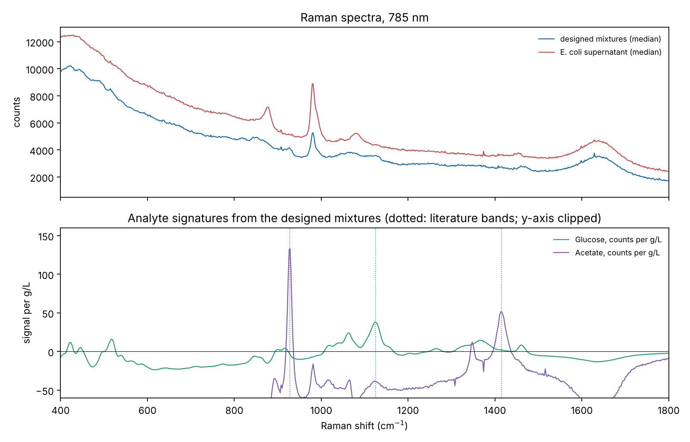
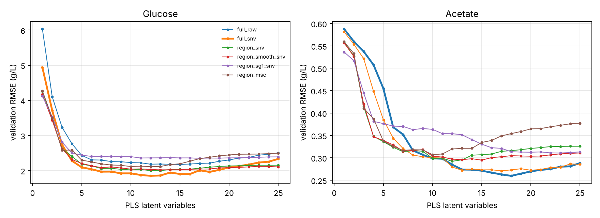
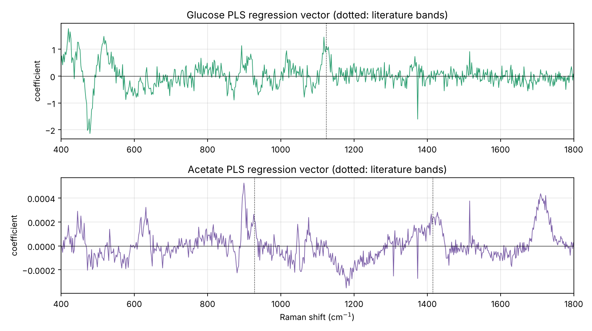
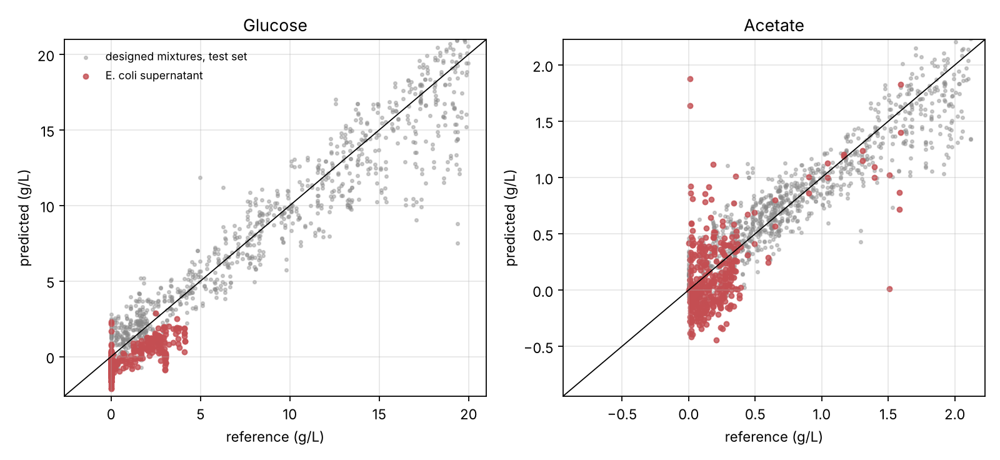
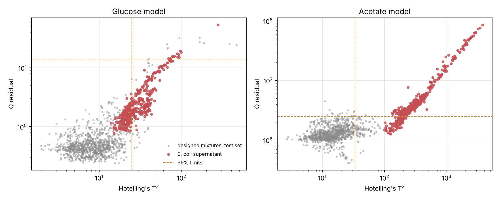
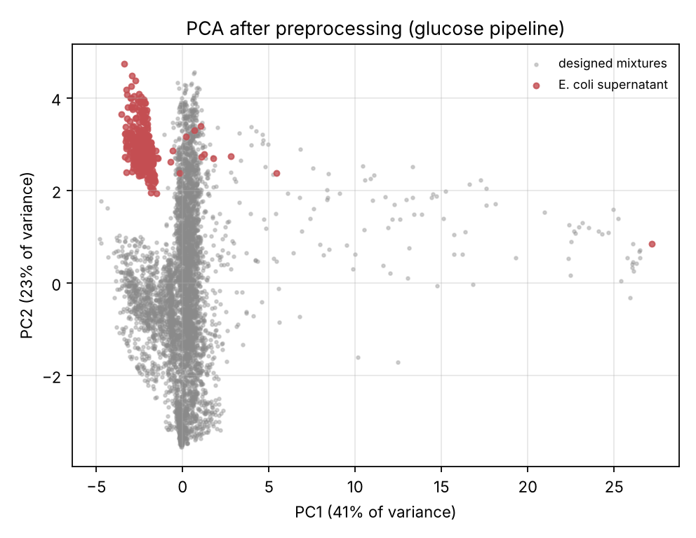
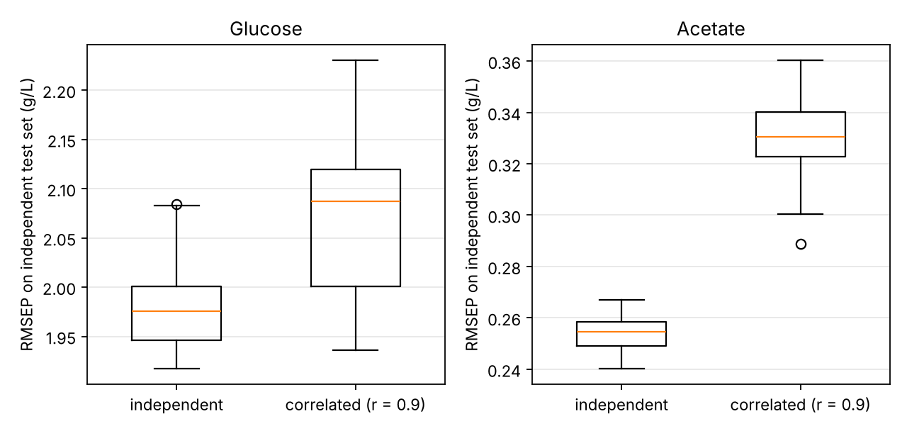
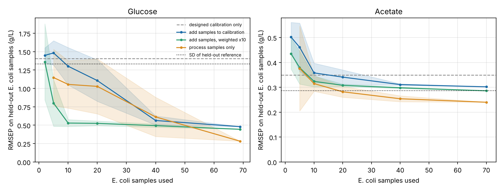

# Raman Bioprocess Chemometrics

**PLS calibration, outlier monitoring, and model maintenance for Raman spectra of bioprocess samples**

**The repository builds partial least squares (PLS) models that predict glucose and acetate from 785 nm Raman spectra, calibrated on 6,960 spectra of designed substrate mixtures and tested on 24 real E. coli cultivations. It covers the workflow of a process analytical technology (PAT) model: Raman preprocessing, model selection, independent validation, Hotelling's T² and Q residual monitoring, PCA, prediction intervals, calibration design, model updating with process samples, and a deployable model package.**

[](https://doi.org/10.5281/zenodo.23310422)
[](https://www.python.org/downloads/)
[](https://scikit-learn.org/)
[](https://opensource.org/licenses/MIT)

---

## DOI and Archival Record

This software is archived on Zenodo to support long-term preservation, reproducibility, and scholarly citation.

**Current Version:** 0.1.1

**DOI (v0.1.1):** https://doi.org/10.5281/zenodo.23310422

---

## Overview

A Raman calibration is often built on prepared samples, where concentrations can be set freely, and then used on real process samples, where the matrix is more complex. This repository asks four questions with two public data sets recorded on the same spectrometer:

- How well does a calibration built on designed mixtures predict glucose and acetate in real fermentation samples?
- Can T² and Q monitoring tell which process predictions to trust?
- Does it matter whether the calibration samples have independent concentrations, or correlated ones as in a real fermentation?
- How many process reference samples are needed to repair a calibration, and how should they be added?

The analysis integrates:

- **Six preprocessing pipelines** with cosmic-ray removal, scatter correction, smoothing, derivatives, and region selection
- **PLS and ridge regression**, selected on a validation set split by sample
- **Independent validation** on 379 spectra from 24 E. coli cultivations
- **Multivariate monitoring** with Hotelling's T² and Q residuals at 99% limits, and PCA
- **Split conformal prediction intervals**
- **A calibration design experiment**: independent against correlated analyte concentrations
- **A model maintenance experiment**: three ways of adding process samples, from 2 to 70 samples
- **A comparison with the source study** under its own cultivation split
- **A deployment bundle** that applies a model to new spectra and flags predictions for review

---

## Key Findings

1. **The designed calibration was accurate on designed samples but did not transfer to fermentation samples.** On held-out designed samples, glucose was predicted with an RMSEP of 1.91 g/L (R² 0.91, range 0 to 20 g/L) and acetate with 0.23 g/L (R² 0.86, range 0 to 2.1 g/L). On the E. coli supernatant the errors were 1.42 g/L for glucose, with a bias of −1.12 g/L, and 0.31 g/L for acetate. Both exceed the spread of the E. coli reference values (standard deviations 1.31 and 0.27 g/L), so the models did no better than predicting the mean.
2. **T² flagged the glucose predictions that were wrong.** All but 3.5% of held-out designed spectra passed the 99% limits, while 55% of E. coli spectra failed them, almost all on T². The RMSEP was 1.76 g/L for flagged E. coli spectra and 0.83 g/L for the rest. For acetate, every E. coli spectrum was flagged, which correctly marks that model as unusable on this matrix.
3. **Correlated calibration samples damaged the weaker analyte.** Calibrations of 400 samples in which glucose and acetate were correlated (r = 0.91), as they are in a fermentation, raised the acetate error on independent test samples by 30% (0.254 to 0.329 g/L) compared with 400 samples drawn at random (r = 0.23). Glucose, the stronger Raman scatterer here, rose by only 4%.
4. **Ten process samples, weighted, repaired the glucose model.** Adding 10 E. coli samples to the designed calibration, each repeated 10 times so that they carry weight among 4,872 designed spectra, cut the glucose error on 16 held-out cultivations from 1.41 to 0.53 g/L. Adding the same samples without weighting reduced it only to 1.30 g/L. A model built on process samples alone needed all 69 available samples to do better (0.28 g/L).
5. **A plain PLS model matched the source study's neural network for glucose.** Using the source study's split (8 cultivations to train, 8 to validate, 8 to test), PLS trained on the 8 training cultivations gave a mean absolute error of 0.22 g/L for glucose and 0.084 g/L for acetate. The convolutional neural network in the source study, trained with 2,261 additional spectra from 8 spectrometers, reported 0.27 and 0.06 g/L.

---

## Scope and Limitations

This repository is a methods study on two public data sets. It is intended for research, education, and methodological comparison.

- One spectrometer, one laboratory, and one organism. The models are not tested on other instruments or processes.
- The E. coli samples are centrifuged supernatants, measured at-line in a flow-through cuvette fed by a liquid handler, not through an in-line probe.
- Most E. coli glucose values are zero during the glucose-limited feeding phase, and most acetate values are below 0.4 g/L. Low concentrations limit how well errors on this set can be compared with the designed set.
- The E. coli files record no cultivation identifier or sampling time. Each pair of replicate spectra is treated as one sample, and the published train, validation, and test files are used as the cultivation split.
- The two designed analytes are not perfectly independent: across all designed samples, glucose and acetate correlate at r = 0.23.
- Process samples were drawn at random from the 8 training cultivations, not in time order.

The models are not validated for process control or for decision-critical use.

---

## Data

Both data sets come from the automated Raman setup at TU Berlin and are distributed on Hugging Face under CC BY 4.0. Both record two spectra per sample and share one wavenumber axis (390.6 to 3384.7 cm⁻¹, 1,870 points), which indicates the same spectrometer (a Metrohm i-Raman Plus with 785 nm excitation in the E. coli study) and means no resampling is needed.

| Set | Spectra | Samples | Analytes | Use |
|---|---|---|---|---|
| [SubstrateMixRaman](https://huggingface.co/datasets/chlange/SubstrateMixRaman) (Lange et al., 2026) | 6,960 | 3,433 | Glucose, glycerol, acetate, EnPump, nitrate, yeast extract, phosphate, sulfate | Calibration, validation, and test |
| [E. coli fermentation](https://huggingface.co/datasets/chlange/RamanSpectraEcoliFermentation) (Lange et al., 2025) | 379 | 190 | Glucose, acetate (Cedex Bio HT) | Independent process test, model updating |

**Data checks.**

- Two designed spectra reach the detector maximum (65,535 counts) and are removed.
- Every spectrum carries a one-pixel artefact at 1713 cm⁻¹, which the spike filter removes.
- The published SubstrateMixRaman splits place the two replicate spectra of a sample in different files: 458 of the 659 glucose test spectra share a sample with a training spectrum. This analysis re-splits the designed data by sample (70/15/15). In this case the shared replicates did not inflate the test score (published-split RMSEP 2.07 g/L; sample-split 1.91 g/L).
- The E. coli files have no such overlap.

---

## Methods

**Preprocessing.** Every pipeline starts with cosmic-ray removal: a point is replaced if it sits far above both a local quadratic fit and a running median over 5 points (modified z-score above 10). This catches spikes of one or two pixels while leaving narrow Raman bands, such as sulfate at 981 cm⁻¹, intact. Pipelines were defined before any results were seen:

| Pipeline | Steps after spike removal |
|---|---|
| full_raw | None |
| full_snv | Standard normal variate (SNV) |
| region_snv | Cut to 800-1600 cm⁻¹, SNV |
| region_smooth_snv | Cut, Savitzky-Golay smoothing (11 points), SNV |
| region_sg1_snv | Cut, Savitzky-Golay first derivative (15 points), SNV |
| region_msc | Cut, multiplicative scatter correction |

The 800-1600 cm⁻¹ region covers the glucose band near 1125 cm⁻¹ and the acetate bands near 928 and 1415 cm⁻¹, and stops below the water bending band near 1640 cm⁻¹.

**Model selection.** PLS models with 1 to 25 latent variables, and ridge regression over seven penalties, were scored on the validation set. The chosen number of latent variables is the smallest within 2% of the minimum validation RMSE. PLS was the primary model; ridge is reported for comparison. Selection used designed data only; E. coli results are reported for information.

**Monitoring.** For each final model, Hotelling's T² measures how far a spectrum's scores lie from the centre of the calibration data, and Q measures the part of the spectrum the model cannot reconstruct. The T² limit uses the F-distribution form for new observations; the Q limit uses Box's scaled chi-squared approximation. Both are set at 99% from the calibration spectra.

**Prediction intervals.** The 95% interval half-width is the appropriate quantile of absolute errors on the validation set (split conformal prediction; Lei et al., 2018). If new spectra resemble the validation spectra, coverage should be close to 95%.

**Analyte signatures.** Because the designed concentrations are nearly independent, a classical least squares fit of the spectra on all eight concentrations estimates each analyte's spectrum per g/L. The glucose signature peaks at 1124 cm⁻¹ and the acetate signature at 928 cm⁻¹, matching literature band positions.

**Calibration design experiment.** From the designed training samples with both analytes measured, 400 samples were drawn either at random or so that glucose and acetate correlate at r ≥ 0.9. A PLS model was fitted to each and scored on the independent test set. This was repeated 20 times.

**Model maintenance experiment.** E. coli samples (both replicates) were drawn at random from the 8 training cultivations, k = 2 to 70 samples, 20 draws each, and scored on the 16 validation and test cultivations (236 glucose and 240 acetate spectra). Three policies were compared with the designed calibration alone:

- **Augment:** add the process samples to the designed calibration and refit with the same number of latent variables
- **Augment, weighted:** as above, with each process spectrum repeated 10 times
- **Local:** a model on the process samples alone, with latent variables chosen by leave-one-sample-out cross-validation

Monitoring limits were rebuilt from each training set.

**Comparison with the source study.** The E. coli files follow the source study's random split of 24 cultivations into 8 training, 8 validation, and 8 test cultivations. PLS models were trained on the training cultivations, the number of latent variables was chosen on the validation cultivations, and errors are reported on the test cultivations.

---

## Results

### Spectra and Analyte Signatures



The E. coli supernatant shows a band near 879 cm⁻¹ that the designed mixtures lack, and a higher background overall. Both are sources of the mismatch described below.

### Preprocessing and Model Selection



| Analyte | Pipeline | Latent variables | Validation RMSE (g/L) | Test RMSEP (g/L) | Test R² |
|---|---|---|---|---|---|
| Glucose | full_snv | 11 | 1.88 | 1.91 | 0.91 |
| Acetate | full_raw | 17 | 0.26 | 0.23 | 0.86 |

The full table for all pipelines and both model types is in `results/model_selection.csv`. Across the six PLS pipelines, the rank correlation between validation error and E. coli error was 0.94 for glucose and 0.14 for acetate: a better designed-data score predicted better transfer for glucose, but not for acetate.



The glucose regression vector has its main positive feature at the 1125 cm⁻¹ glucose band. The acetate vector carries the 928 and 1415 cm⁻¹ bands but also broad background features, which is consistent with its poor transfer: part of what it learned is background that differs between the two matrices.

### Transfer to E. coli Samples



| Analyte | E. coli spectra | RMSEP (g/L) | Bias (g/L) | R² | Reference SD (g/L) |
|---|---|---|---|---|---|
| Glucose | 373 | 1.42 | −1.12 | −0.16 | 1.31 |
| Acetate | 379 | 0.31 | −0.07 | −0.37 | 0.27 |

Glucose predictions follow the trend of the reference values but sit about 1 g/L too low, so many zero-glucose samples are predicted below zero.

### Monitoring and PCA



| Model | 99% limits (T², Q) | Designed test spectra flagged | E. coli spectra flagged | E. coli RMSEP, flagged / not flagged |
|---|---|---|---|---|
| Glucose | 24.8, 14.1 | 3.5% | 55% | 1.76 / 0.83 g/L |
| Acetate | 33.6, 2.5 × 10⁶ | 9.4% | 100% | all flagged |



The E. coli spectra form a separate cluster from the designed mixtures on the first two principal components (41% and 23% of variance).

**Prediction intervals.** The glucose interval (±3.52 g/L) covered 94% of designed test values and 99% of E. coli values; the acetate interval (±0.53 g/L) covered 97% and 95%. Coverage held, but the glucose interval is wider than the whole E. coli range, so it is honest without being useful for this process.

### Calibration Design



| Analyte | Independent design, RMSEP (g/L) | Correlated design, RMSEP (g/L) | Change |
|---|---|---|---|
| Glucose | 1.99 ± 0.05 | 2.07 ± 0.08 | +4% |
| Acetate | 0.254 ± 0.007 | 0.329 ± 0.018 | +30% |

Values are mean ± standard deviation over 20 draws; training correlation was 0.23 for the random draws and 0.91 for the correlated ones. The correlated design was worse in 20 of 20 paired draws for acetate and 18 of 20 for glucose (Wilcoxon signed-rank p < 0.001 and p = 0.001). When the two analytes rise and fall together in the calibration, the model can predict the weak acetate signal partly from the strong glucose signal. That shortcut fails as soon as the correlation breaks, as it does in the test set and in any new process.

### Model Maintenance



**Glucose** (16 held-out cultivations; designed calibration alone: 1.41 g/L)

| Process samples | Augment | Augment, weighted | Local |
|---|---|---|---|
| 2 | 1.45 | 1.36 | |
| 5 | 1.48 | 0.80 | 1.15 |
| 10 | 1.30 | 0.53 | 1.06 |
| 20 | 1.11 | 0.53 | 1.03 |
| 40 | 0.56 | 0.49 | 0.61 |
| 69 (all) | 0.48 | 0.44 | 0.28 |

**Acetate** (designed calibration alone: 0.35 g/L; reference SD 0.29 g/L)

| Process samples | Augment | Augment, weighted | Local |
|---|---|---|---|
| 10 | 0.36 | 0.32 | 0.32 |
| 40 | 0.31 | 0.30 | 0.25 |
| 70 (all) | 0.30 | 0.29 | 0.24 |

Values are mean RMSEP in g/L over 20 random draws. With few process samples, the weighted update gave the best glucose model; with all 69, the local model was best. After the weighted 10-sample update, 19% of held-out E. coli spectra were flagged, down from 55%. Acetate in this process stayed near the limit of what these spectra resolve: no policy brought the error clearly below the spread of the reference values until 40 or more process samples were used.

### Robustness Over Five Splits

`scripts/robustness.py` repeats the headline results with five random sample-wise splits of the designed data, re-selecting preprocessing and latent variables each time (output in `results/robustness.csv` and `results/robustness_summary.json`).

| Quantity | Glucose | Acetate |
|---|---|---|
| Designed test RMSEP (g/L) | 1.99 ± 0.10 (1.90 to 2.10) | 0.25 ± 0.02 (0.23 to 0.26) |
| E. coli RMSEP (g/L) | 2.25 ± 1.67 (0.61 to 4.36) | 0.37 ± 0.11 (0.30 to 0.57) |
| E. coli bias (g/L) | −1.43 ± 1.96 (−3.71 to 0.73) | 0.12 ± 0.21 (−0.07 to 0.44) |
| E. coli spectra flagged at 99% | 60% ± 27% (26% to 88%) | 100% in every split |
| Held-out RMSEP, designed calibration only (g/L) | 2.27 ± 1.70 | 0.41 ± 0.11 |
| Held-out RMSEP, 10 samples weighted ×10 (g/L) | 0.78 ± 0.23 | 0.33 ± 0.01 |

The designed-sample error barely moved, while the E. coli error and bias changed widely from split to split: the designed calibration extrapolates to the fermentation matrix, and how it extrapolates depends on which designed samples it was trained on. The flagged fraction rose with the E. coli error across splits, and the weighted 10-sample update reduced the glucose error in every split. With the source study's split, the bootstrap 95% interval for the PLS glucose MAE is 0.17 to 0.29 g/L, which contains the CNN's 0.27 g/L; for acetate it is 0.071 to 0.097 g/L, above the CNN's 0.06 g/L.

### Comparison with the Source Study

Same split as the source study: 8 training, 8 validation, and 8 test cultivations (122 test spectra).

| Model | Glucose MAE (g/L) | Acetate MAE (g/L) |
|---|---|---|
| PLS, designed calibration only | 1.15 | 0.238 |
| PLS, E. coli training cultivations only | **0.22** | 0.084 |
| PLS, designed calibration + E. coli training cultivations (×10) | 0.30 | 0.159 |
| CNN trained with 2,261 additional spectra from 8 spectrometers (Lange et al., 2025) | 0.27 | **0.06** |

Adding the designed calibration did not help once 8 cultivations of process data were available. The acetate test cultivations are low in acetate (standard deviation 0.13 g/L), so the absolute errors there are small for every model.

---

## Installation

### Requirements

- Python 3.10 or higher
- NumPy, SciPy, pandas, scikit-learn, Matplotlib, chemotools, joblib, huggingface_hub, pytest

### Setup

```bash
# Clone the repository
git clone https://github.com/Oluwaseun-O-Ajayi/raman-bioprocess-chemometrics.git
cd raman-bioprocess-chemometrics

# Install dependencies
pip install -r requirements.txt

# Run the test suite
pytest -q
```

---

## Usage

### Download the Data

```bash
python scripts/download_data.py
```

This saves both data sets (about 95 MB) to `data/substratemix/` and `data/ecoli/`. The data are not stored in the repository.

### Full Analysis

```bash
python scripts/run_analysis.py
```

This writes all tables to `results/`, all figures to `figures/`, and one deployable model per analyte to `models/`. It takes about 15 minutes on a 2-core laptop, most of it in the 20-draw maintenance and design experiments.

### Applying a Model to New Spectra

```bash
python scripts/predict.py new_spectra.csv --model models/glucose_pls.joblib --out predictions.csv
```

The input CSV has one spectrum per row with Raman shifts as column headers. The script refuses spectra on a different wavenumber axis. For each spectrum it reports the prediction, the 95% interval, T², Q, and whether the prediction should be reviewed (T² or Q above the 99% limit, or a prediction outside the calibration range). The model file records its preprocessing, latent variables, calibration size, validation RMSE, build date, and package version.

---

## Project Structure

```
raman-bioprocess-chemometrics/
├── ramanpat/
│   ├── data.py           # Loading, download, sample groups, splits, spectrum checks
│   ├── raman.py          # Cosmic-ray removal
│   ├── preprocessing.py  # Six preprocessing pipelines
│   ├── models.py         # PLS, ridge, validation selection, analyte signatures
│   ├── monitoring.py     # Hotelling's T², Q residuals, control limits
│   ├── uncertainty.py    # Split conformal prediction intervals
│   ├── lifecycle.py      # Calibration design and model maintenance experiments, PCA
│   ├── deploy.py         # Model bundle, axis check, flagged predictions
│   └── figures.py
├── scripts/
│   ├── download_data.py
│   ├── run_analysis.py
│   ├── robustness.py
│   └── predict.py
├── tests/                # 14 unit tests on synthetic spectra
├── results/              # CSV tables and summary.json
└── figures/
```

---

## Testing

The 14 tests run in about 2 seconds on synthetic spectra, so they need no data download. They check:

- **Data handling:** invalid and saturated spectra are removed, and replicate spectra never cross splits.
- **Preprocessing and models:** every pipeline returns finite values on the expected axis, and the fast PLS path matches refitted models. PLS recovers a known signal, and classical least squares recovers known band shapes.
- **Spike removal:** spikes are removed without clipping bands or steps.
- **Monitoring and intervals:** the T² limit matches its formula, Q flags an added band, and conformal intervals reach their stated coverage.
- **Experiments and deployment:** the design experiment reaches its target correlation, and the update experiment improves a shifted process. A saved model reproduces its predictions and rejects a mismatched axis.

```bash
pytest -q
```

---

## Output Files

- `results/model_selection.csv`: validation, test, and E. coli errors for every pipeline and model
- `results/pls_validation_curves.csv`: validation RMSE against latent variables
- `results/ecoli_predictions_glucose.csv`, `results/ecoli_predictions_acetate.csv`: predictions, T², Q, and flags per E. coli spectrum
- `results/calibration_design.csv`: the design experiment, one row per draw
- `results/model_update.csv`, `results/model_update_summary.csv`: the maintenance experiment
- `results/summary.json`: headline numbers, data checks, and the comparison with the source study
- `results/robustness.csv`, `results/robustness_summary.json`: results over five splits and bootstrap intervals
- `figures/`: all figures shown above

---

## Research Applications

- **Bioprocess monitoring:** Raman calibration for substrates and products in fermentation and cell culture
- **Calibration design:** planning prepared-sample calibrations that do not rely on correlations a process may break
- **Model lifecycle management:** deciding when a deployed model can be trusted, and how many process samples an update needs
- **Teaching:** a compact, tested reference implementation of PLS, T² and Q monitoring, and conformal intervals

---

## Future Work

- Updates drawn in time order within cultivations, once sampling times are available
- Calibration transfer to other spectrometers using the multi-instrument data from the same group
- Weighting chosen by validation instead of fixed in advance
- Prediction of the other six designed analytes in process samples

---

## References

- Lange, C., Altmann, M., Stors, D., Seidel, S., Moynahan, K., Cai, L., Born, S., Neubauer, P., & Cruz Bournazou, M. N. (2026). Deep learning for Raman spectroscopy: Benchmarking models for upstream bioprocess monitoring. *Measurement*, 258, 118884. https://doi.org/10.1016/j.measurement.2025.118884
- Lange, C., Seidel, S., Altmann, M., Stors, D., Kemmer, A., Cai, L., Born, S., Neubauer, P., & Cruz Bournazou, M. N. (2025). A setup for automatic Raman measurements in high-throughput experimentation. *Biotechnology and Bioengineering*, 122(10), 2751-2769. https://doi.org/10.1002/bit.70006
- Wold, S., Sjöström, M., & Eriksson, L. (2001). PLS-regression: a basic tool of chemometrics. *Chemometrics and Intelligent Laboratory Systems*, 58(2), 109-130.
- Barnes, R. J., Dhanoa, M. S., & Lister, S. J. (1989). Standard normal variate transformation and de-trending of near-infrared diffuse reflectance spectra. *Applied Spectroscopy*, 43(5), 772-777.
- Geladi, P., MacDougall, D., & Martens, H. (1985). Linearization and scatter-correction for near-infrared reflectance spectra of meat. *Applied Spectroscopy*, 39(3), 491-500.
- Savitzky, A., & Golay, M. J. E. (1964). Smoothing and differentiation of data by simplified least squares procedures. *Analytical Chemistry*, 36(8), 1627-1639.
- Whitaker, D. A., & Hayes, K. (2018). A simple algorithm for despiking Raman spectra. *Chemometrics and Intelligent Laboratory Systems*, 179, 82-84.
- Jackson, J. E., & Mudholkar, G. S. (1979). Control procedures for residuals associated with principal component analysis. *Technometrics*, 21(3), 341-349.
- Box, G. E. P. (1954). Some theorems on quadratic forms applied in the study of analysis of variance problems, I. *Annals of Mathematical Statistics*, 25(2), 290-302.
- Lei, J., G'Sell, M., Rinaldo, A., Tibshirani, R. J., & Wasserman, L. (2018). Distribution-free predictive inference for regression. *Journal of the American Statistical Association*, 113(523), 1094-1111.

---

## License

MIT License. See `LICENSE`. The data sets are CC BY 4.0 and belong to their authors.

---

## Citation

If you use this repository in research or teaching, please cite:

```text
Ajayi, O. O. (2026).

Raman Bioprocess Chemometrics: PLS calibration, outlier monitoring, and model maintenance for Raman spectra of bioprocess samples
(Version 0.1.1) [Computer software].

Zenodo.

DOI: 10.5281/zenodo.23310422
```

### BibTeX

```bibtex
@software{raman_bioprocess_chemometrics_2026,
  author = {Ajayi, Oluwaseun O.},
  title = {Raman Bioprocess Chemometrics: PLS calibration, outlier monitoring, and model maintenance for Raman spectra of bioprocess samples},
  year = {2026},
  version = {0.1.1},
  publisher = {Zenodo},
  doi = {10.5281/zenodo.23310422},
  url = {https://doi.org/10.5281/zenodo.23310422}
}
```

---

## Author

**Oluwaseun O. Ajayi**
Department of Chemistry, University of Georgia
ORCID: [0000-0003-0040-7217](https://orcid.org/0000-0003-0040-7217)
